# Gebäudeplatzierung, Grid und Segmente

Stand: 16. November 2026. Touch, Gebäudeauswahl, Spieler- und Startplatzierung, Zellbelegung und Segmentrotation. Ressourcenklassen sind als angrenzende Komponenten mit enthalten.

[Legende und Einordnung](README.md) · [SVG öffnen](01-Platzierung-und-Segmente.svg) · [Offline-Ansicht](UML.html)

```mermaid
classDiagram
direction LR
class InputManager {
  <<MonoBehaviour>>
  +event Action~Vector2~ OnFingerMoved
  +event Action~Vector2~ OnFingerBegan
  +event Action~Vector2~ OnFingerEnded
  +event Action~int~ OnSwipe
  +event Action~Vector2~ OnTap
  -float swipeRange
  -OnEnable() void
  -Update() void
  +TrackFingerPosition(Touch touch) Vector2
  +TrackFingerStartPosition(Touch touch) Vector2
  +TrackFingerEndPosition(Touch touch) Vector2
  +OnDisable() void
}
class BuildingUI {
  <<MonoBehaviour>>
  +event Action~BuildingModel~ OnBuildingSelected
  +event Action~bool~ OnNextRoundPressed
  -Button buildingButton
  -GameObject buildingPanel
  -SegmentRotation segmentRotation
  -Button building1
  -Button building2
  -Button building3
  -Button nextRound
  -BuildingModel building1x1
  -BuildingModel building2x2
  -BuildingModel building3x3
  -TextMeshProUGUI text1x1Building
  -TextMeshProUGUI text2x2Building
  -TextMeshProUGUI text3x3Building
  -Image resourceImage1x1
  -Image resourceImage2x2
  -Image resourceImage3x3
  -BuildingModel wheedBuilding
  -BuildingModel woodBuilding
  -BuildingModel flachsBuilding
  +Start() void
  +OnBuildingButtonClicked() void
  +BuildingFinished() void
  +OnBuilding1Clicked() void
  +OnBuilding2Clicked() void
  +OnBuilding3Clicked() void
  +OnEndRoundWasClicked() void
  +ShowCostBuilding(BuildingData buildingData, TextMeshProUGUI text, Image image) void
  +RefreshUiButtons() void
}
class BuildingPlacement {
  <<MonoBehaviour>>
  -Camera mainCamera
  -InputManager inputManager
  -BuildingUI buildingUI
  -Material positive
  -Material negative
  -MainStorrage mainStorrage
  -SegmentRotation segmentRotation
  -GameObject placementPanel
  -Button confirmButton
  -Button cancelButton
  -Button rotateButton
  -BuildingModel currentPreview
  -ResourceData buildingResource
  -bool isDragging
  -GridManager grid
  -MeshCollider meshCollider
  -SegmentStorage segmentStorage
  +bool isPlacing
  +Start() void
  -OnEnable() void
  -Update() void
  -CanclePlacement() void
  -RotatePreview() void
  +OnTouchBegan(Vector2 pos) void
  +OnTouchMoved(Vector2 pos) void
  +OnTouchEnded(Vector2 pos) void
  +GetSelectedBuilding(BuildingModel buildingPrefab) void
  +PlaceBuilding() void
  -ClearPreview() void
  -OnDisable() void
}
class BuildingModel {
  <<MonoBehaviour>>
  -GameObject wrapper
  -BuildingData buildingData
  +BuildingData Data
  +float rotation
  -BuildingShapeUnit[] shapeUnits
  -Renderer[] renderers
  -Material[][] originalMaterials
  -Material previewMaterial
  -ResourceProduction production
  -bool isPreview
  -bool isPlaced
  +Awake() void
  +BeginPreview() void
  +SetPreviewMaterial(Material material) void
  +CompletePlacement(GridManager targetGrid, SegmentStorage segmentStorage) bool
  +Rotate(float rotationStep) void
  +GetAllBuildingPositions() List~Vector3~
}
class BuildingStartPlacement {
  <<MonoBehaviour>>
  -BuildingModel building
  -GridManager grid
  -SegmentStorage segmentStorage
  -SnapToGrid() void
  -Start() void
}
class BuildingShapeUnit {
  <<MonoBehaviour>>
}
class GridManager {
  <<MonoBehaviour>>
  -int width
  -int height
  -float cellSize
  -MeshCollider meshCollider
  -BuildingGridCell[,] grid
  +bool IsReady
  -Awake() void
  +GridToWorldPosition(int x, int z) Vector3
  +WorldToGridPosition(Vector3 worldPos) ValueTuple
  +TrySetBuilding(BuildingModel building, List~Vector3~ allBuildingPositions) bool
  +CanBuild(List~Vector3~ allBuildingPositions) bool
  +OnDrawGizmos() void
  +IsCellOnCollider(int x, int z) bool
  +GridToWorldCenterPosition(int x, int z) Vector3
}
class BuildingGridCell {
  -BuildingModel building
  -bool isBuildable
  +SetBuilding(BuildingModel building) void
  +SetBuildable(bool isBuild) void
  +GetBuildable() bool
  +IsEmpty() bool
}
class Segment {
  <<MonoBehaviour>>
  +GridManager grid
  +MeshCollider surface
  +SegmentStorage segmentStorage
  +ResourceData allowedResources
  +Transform buildingParents
}
class SegmentRotation {
  <<MonoBehaviour>>
  -InputManager inputManager
  -float rotationStep
  -float rotationDuration
  -BuildingPlacement buildingPlacement
  -GameObject rotationPivot
  -BuildingUI buildingUI
  -Segment[] segments
  -int currentSegmentIndex
  +Segment currentSegment
  +bool isRotating
  -OnEnable() void
  -RotateOnSwipe(int amount) void
  -Rotate(int amount) IEnumerator
  -OnDisable() void
}
class BuildingData {
  <<ScriptableObject>>
  +string description
  +ResourceData costResource
  +int cost
  +BuildingType type
  +ResourceData resource
  +int resourceQuantity
  +int maxStorage
}
class ResourceProduction {
  <<MonoBehaviour>>
  -SegmentStorage producerForStorage
  -int productionQuantity
  -ResourceData producedResource
  -ResourceDisplayUI displayUI
  +Setup(BuildingData buildingData, SegmentStorage segmentStorage) void
  +ProduceResource() void
  +OnDestroy() void
}
class SegmentStorage {
  <<MonoBehaviour>>
  -BuildingData buildingData
  +ResourceData storedResource
  -List~ResourceProduction~ resourceBuildings
  +int currentAmount
  +int maxCapacity
  +int assignedCarts
  +Awake() void
  +AddResources(int amount) void
  +RemoveResources(int amount) int
  +RegisterProducer(ResourceProduction productionBuilding) void
  +RemoveProducer(ResourceProduction productionBuilding) void
  +ProducePerRound() void
  +AssignCart() bool
  +RemoveCarts() bool
}
class MainStorrage {
  <<MonoBehaviour>>
  +int wood
  +int wheed
  +int flachs
  +int gold
  -int startWood
  -int startWheed
  -int startFlachs
  -int startGold
  +Start() void
  +AddResources(int amount, ResourceData resource) void
  +RemoveResource(int amount, ResourceData resource) void
  +HasResources(int amount, ResourceData resource) bool
}
BuildingModel --> "0..*" BuildingShapeUnit : shapeUnits
BuildingModel --> "0..1" ResourceProduction : production
BuildingModel --> BuildingData : buildingData, Data
BuildingPlacement --> "0..1" BuildingModel : currentPreview
BuildingPlacement --> MainStorrage : mainStorrage
BuildingPlacement --> SegmentStorage : segmentStorage
BuildingPlacement --> SegmentRotation : segmentRotation
BuildingPlacement --> GridManager : grid
BuildingPlacement --> InputManager : inputManager
BuildingPlacement --> BuildingUI : buildingUI
BuildingStartPlacement --> BuildingModel : building
BuildingStartPlacement --> SegmentStorage : segmentStorage
BuildingStartPlacement --> GridManager : grid
ResourceProduction --> SegmentStorage : producerForStorage
SegmentStorage --> "0..*" ResourceProduction : resourceBuildings
SegmentStorage --> BuildingData : buildingData
Segment --> SegmentStorage : segmentStorage
Segment --> GridManager : grid
SegmentRotation --> BuildingPlacement : buildingPlacement
SegmentRotation --> "0..*" Segment : segments, currentSegment
SegmentRotation --> InputManager : inputManager
SegmentRotation --> BuildingUI : buildingUI
GridManager *-- "0..*" BuildingGridCell : grid
BuildingGridCell --> "0..1" BuildingModel : building
BuildingUI --> BuildingModel : building1x1, building2x2, building3x3, wheedBuilding, woodBuilding, flachsBuilding
BuildingUI --> SegmentRotation : segmentRotation
BuildingModel ..> GridManager : CompletePlacement / TrySetBuilding
BuildingModel ..> SegmentStorage : CompletePlacement / Setup
BuildingPlacement ..> BuildingData : liest Data und Baukosten
BuildingPlacement ..> Segment : liest aktuelles Segment
BuildingUI ..> BuildingData : ShowCostBuilding / Data
GridManager ..> BuildingModel : TrySetBuilding
ResourceProduction ..> BuildingData : Setup
SegmentStorage ..> BuildingModel : GetComponent / Data
BuildingPlacement ..> InputManager : abonniert OnFingerBegan/Moved/Ended
SegmentRotation ..> InputManager : abonniert OnSwipe
BuildingPlacement ..> BuildingUI : abonniert OnBuildingSelected
style InputManager fill:#e0f2fe,stroke:#475569,color:#0f172a
style BuildingUI fill:#e0f2fe,stroke:#475569,color:#0f172a
style BuildingPlacement fill:#dcfce7,stroke:#475569,color:#0f172a
style BuildingModel fill:#dcfce7,stroke:#475569,color:#0f172a
style BuildingStartPlacement fill:#dcfce7,stroke:#475569,color:#0f172a
style BuildingShapeUnit fill:#dcfce7,stroke:#475569,color:#0f172a
style GridManager fill:#dcfce7,stroke:#475569,color:#0f172a
style BuildingGridCell fill:#dcfce7,stroke:#475569,color:#0f172a
style Segment fill:#e0f2fe,stroke:#475569,color:#0f172a
style SegmentRotation fill:#e0f2fe,stroke:#475569,color:#0f172a
style BuildingData fill:#ede9fe,stroke:#475569,color:#0f172a
style ResourceProduction fill:#fef3c7,stroke:#475569,color:#0f172a
style SegmentStorage fill:#fef3c7,stroke:#475569,color:#0f172a
style MainStorrage fill:#fef3c7,stroke:#475569,color:#0f172a
```

