# Runden, Ressourcen, Wagen und Lager-UI

Stand: 16. November 2026. Pro Segment ein Transport mit Lagerbezug; RoundManager startet alle konfigurierten Transporte vor der Produktion. SplineAnimate ist eine externe Unity-Paketklasse.

[Legende und Einordnung](README.md) · [SVG öffnen](02-Ressourcen-und-Transport.svg) · [Offline-Ansicht](UML.html)

```mermaid
classDiagram
direction LR
class RoundManager {
  <<MonoBehaviour>>
  -BuildingUI ui
  -List~SegmentStorage~ storages
  -DemendManger demendManger
  +int currentRound
  -List~TransportManager~ transports
  -OnEnable() void
  +StartNextRound(bool isRoundFinished) void
  -OnDisable() void
}
class ResourceProduction {
  <<MonoBehaviour>>
  -SegmentStorage producerForStorage
  -int productionQuantity
  -ResourceData producedResource
  -ResourceDisplayUI displayUI
  +Setup(BuildingData buildingData, SegmentStorage segmentStorage) void
  +ProduceResource() void
  +OnDestroy() void
}
class SegmentStorage {
  <<MonoBehaviour>>
  -BuildingData buildingData
  +ResourceData storedResource
  -List~ResourceProduction~ resourceBuildings
  +int currentAmount
  +int maxCapacity
  +int assignedCarts
  +Awake() void
  +AddResources(int amount) void
  +RemoveResources(int amount) int
  +RegisterProducer(ResourceProduction productionBuilding) void
  +RemoveProducer(ResourceProduction productionBuilding) void
  +ProducePerRound() void
  +AssignCart() bool
  +RemoveCarts() bool
}
class MainStorrage {
  <<MonoBehaviour>>
  +int wood
  +int wheed
  +int flachs
  +int gold
  -int startWood
  -int startWheed
  -int startFlachs
  -int startGold
  +Start() void
  +AddResources(int amount, ResourceData resource) void
  +RemoveResource(int amount, ResourceData resource) void
  +HasResources(int amount, ResourceData resource) bool
}
class CartManager {
  <<MonoBehaviour>>
  -int totalCarts
  +int TotalCarts
  +int availableCarts
  -Awake() void
  +AssignCart(SegmentStorage storage) bool
  +RemoveCart(SegmentStorage storage) bool
}
class TransportManager {
  <<MonoBehaviour>>
  -SegmentStorage segmentStorage
  -MainStorrage mainStorage
  -Transform startStoragPos
  -Transform mainStoragePos
  -GameObject cart
  -SplineAnimate splineAnimate
  -ResourceDisplayUI resourceDisplayUI
  -int transportCapacity
  +int currentLoad
  +float moveSpeed
  -bool isDriving
  +ResourceData resourceData
  -Update() void
  +StartTransport() void
  +MoveToMainStorage(float kmh) IEnumerator
  +MoveBackToSegmentStorage(float kmh) IEnumerator
  +TranportLifeCycle(Transform startPos, Transform targetPos, float kmh) IEnumerator
}
class SplineAnimate {
  <<external>>
}
class ResourceDisplayUI {
  <<MonoBehaviour>>
  -Image resourceIcon
  -TextMeshProUGUI quantity
  +SetResource(ResourceData resource) void
  +SetQuantity(int amount) void
}
class SegmentStorageUI {
  <<MonoBehaviour>>
  -GameObject segmentStorageUi
  -Image resourceImage
  -TextMeshProUGUI amountText
  -Button closeButton
  -CartManager cartManager
  -Vector3 panelOffset
  -InputManager inputManager
  -Camera mainCamera
  -Button cartSlot1
  -Button cartSlot2
  -Button cartSlot3
  -Sprite slotEmpty
  -Sprite slotFull
  -SegmentStorage segmentStorage
  +OnEnable() void
  +Start() void
  +OpenUI(Vector2 pos) void
  +CloseUI() void
  -GetStorageAtPosition(Vector2 pos) SegmentStorage
  -ToggleCart(int slot) void
  -RefreshCartButtons() void
  +OnDisable() void
}
class UIOverview {
  <<MonoBehaviour>>
  -MainStorrage mainStorrage
  -RoundManager roundManager
  -CartManager cartManager
  -TextMeshProUGUI flachsText
  -TextMeshProUGUI wheedText
  -TextMeshProUGUI woodText
  -TextMeshProUGUI currentRound
  -TextMeshProUGUI availabelCarts
  +Update() void
}
class ResourceData {
  <<ScriptableObject>>
  +ResourceType resourceType
  +string name
  +Sprite icon
}
class BuildingData {
  <<ScriptableObject>>
  +string description
  +ResourceData costResource
  +int cost
  +BuildingType type
  +ResourceData resource
  +int resourceQuantity
  +int maxStorage
}
class BuildingModel {
  <<MonoBehaviour>>
  -GameObject wrapper
  -BuildingData buildingData
  +BuildingData Data
  +float rotation
  -BuildingShapeUnit[] shapeUnits
  -Renderer[] renderers
  -Material[][] originalMaterials
  -Material previewMaterial
  -ResourceProduction production
  -bool isPreview
  -bool isPlaced
  +Awake() void
  +BeginPreview() void
  +SetPreviewMaterial(Material material) void
  +CompletePlacement(GridManager targetGrid, SegmentStorage segmentStorage) bool
  +Rotate(float rotationStep) void
  +GetAllBuildingPositions() List~Vector3~
}
class InputManager {
  <<MonoBehaviour>>
  +event Action~Vector2~ OnFingerMoved
  +event Action~Vector2~ OnFingerBegan
  +event Action~Vector2~ OnFingerEnded
  +event Action~int~ OnSwipe
  +event Action~Vector2~ OnTap
  -float swipeRange
  -OnEnable() void
  -Update() void
  +TrackFingerPosition(Touch touch) Vector2
  +TrackFingerStartPosition(Touch touch) Vector2
  +TrackFingerEndPosition(Touch touch) Vector2
  +OnDisable() void
}
class BuildingUI {
  <<MonoBehaviour>>
  +event Action~BuildingModel~ OnBuildingSelected
  +event Action~bool~ OnNextRoundPressed
  -Button buildingButton
  -GameObject buildingPanel
  -SegmentRotation segmentRotation
  -Button building1
  -Button building2
  -Button building3
  -Button nextRound
  -BuildingModel building1x1
  -BuildingModel building2x2
  -BuildingModel building3x3
  -TextMeshProUGUI text1x1Building
  -TextMeshProUGUI text2x2Building
  -TextMeshProUGUI text3x3Building
  -Image resourceImage1x1
  -Image resourceImage2x2
  -Image resourceImage3x3
  -BuildingModel wheedBuilding
  -BuildingModel woodBuilding
  -BuildingModel flachsBuilding
  +Start() void
  +OnBuildingButtonClicked() void
  +BuildingFinished() void
  +OnBuilding1Clicked() void
  +OnBuilding2Clicked() void
  +OnBuilding3Clicked() void
  +OnEndRoundWasClicked() void
  +ShowCostBuilding(BuildingData buildingData, TextMeshProUGUI text, Image image) void
  +RefreshUiButtons() void
}
class DemendManger {
  <<MonoBehaviour>>
  +event Action OnDemandDisplayRequested
  +event Action OnDemandCompleted
  -List~DemandData~ demands
  -MainStorrage mainStorrage
  -BarometerManager barometerManager
  -DemandData currentDemend
  -int nextDemandIndex
  -int dueRound
  -int latestRound
  +TriggerDemand(DemandData demand, int currentRound) void
  +CheckDemandsForRound(int currentRound) void
  +GiveAll() void
  +GiveHalf() void
  +MoreTime() void
  +HasActiveDemand() bool
  +CanGiveAll() bool
  +CanGiveHalf() bool
  -CompleteDemand() void
  +GetRemainingRounds() int
}
BuildingModel --> "0..1" ResourceProduction : production
BuildingModel --> BuildingData : buildingData, Data
ResourceProduction --> SegmentStorage : producerForStorage
ResourceProduction --> ResourceData : producedResource
ResourceProduction --> ResourceDisplayUI : displayUI
SegmentStorage --> "0..*" ResourceProduction : resourceBuildings
SegmentStorage --> BuildingData : buildingData
SegmentStorage --> ResourceData : storedResource
DemendManger --> MainStorrage : mainStorrage
RoundManager --> "0..*" SegmentStorage : storages
RoundManager --> DemendManger : demendManger
RoundManager --> "0..*" TransportManager : transports
RoundManager --> BuildingUI : ui
BuildingData --> ResourceData : costResource, resource
TransportManager --> MainStorrage : mainStorage
TransportManager --> SegmentStorage : segmentStorage
TransportManager --> ResourceData : resourceData
TransportManager --> ResourceDisplayUI : resourceDisplayUI
BuildingUI --> BuildingModel : building1x1, building2x2, building3x3, wheedBuilding, woodBuilding, flachsBuilding
SegmentStorageUI --> SegmentStorage : segmentStorage
SegmentStorageUI --> InputManager : inputManager
SegmentStorageUI --> CartManager : cartManager
UIOverview --> MainStorrage : mainStorrage
UIOverview --> RoundManager : roundManager
UIOverview --> CartManager : cartManager
BuildingModel ..> SegmentStorage : CompletePlacement / Setup
BuildingUI ..> BuildingData : ShowCostBuilding / Data
BuildingUI ..> ResourceData : vergleicht allowedResources und Icons
ResourceProduction ..> BuildingData : Setup
SegmentStorage ..> BuildingModel : GetComponent / Data
MainStorrage ..> ResourceData : Ressourcentyp in Methoden
CartManager ..> SegmentStorage : AssignCart / RemoveCart
ResourceDisplayUI ..> ResourceData : SetResource
SegmentStorageUI ..> InputManager : abonniert OnTap
RoundManager ..> BuildingUI : abonniert OnNextRoundPressed
TransportManager --> SplineAnimate : splineAnimate
style RoundManager fill:#e0f2fe,stroke:#475569,color:#0f172a
style ResourceProduction fill:#fef3c7,stroke:#475569,color:#0f172a
style SegmentStorage fill:#fef3c7,stroke:#475569,color:#0f172a
style MainStorrage fill:#fef3c7,stroke:#475569,color:#0f172a
style CartManager fill:#fef3c7,stroke:#475569,color:#0f172a
style TransportManager fill:#fef3c7,stroke:#475569,color:#0f172a
style ResourceData fill:#ede9fe,stroke:#475569,color:#0f172a
style BuildingData fill:#ede9fe,stroke:#475569,color:#0f172a
style BuildingModel fill:#dcfce7,stroke:#475569,color:#0f172a
style InputManager fill:#e0f2fe,stroke:#475569,color:#0f172a
style BuildingUI fill:#e0f2fe,stroke:#475569,color:#0f172a
style DemendManger fill:#fce7f3,stroke:#475569,color:#0f172a
```

