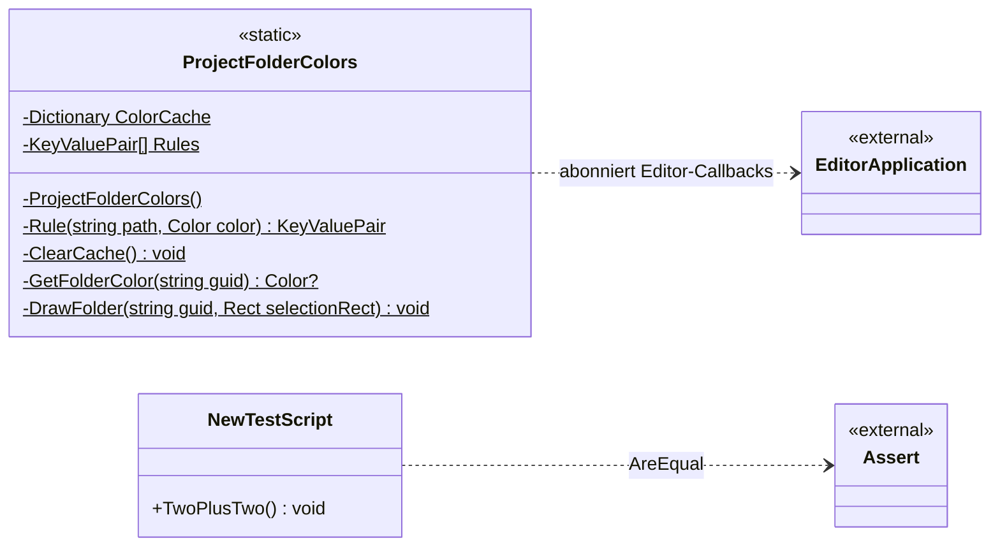

# Editor-Werkzeug und Testklasse

Stand: 16. November 2026. Getrennt vom Spielablauf: statische Projektordner-Färbung und der bestehende TwoPlusTwo-Test. Die Testklasse prüft keine Gameplay-Funktion.

[Legende und Einordnung](README.md) · [SVG öffnen](06-Editor-und-Tests.svg) · [Offline-Ansicht](UML.html)

