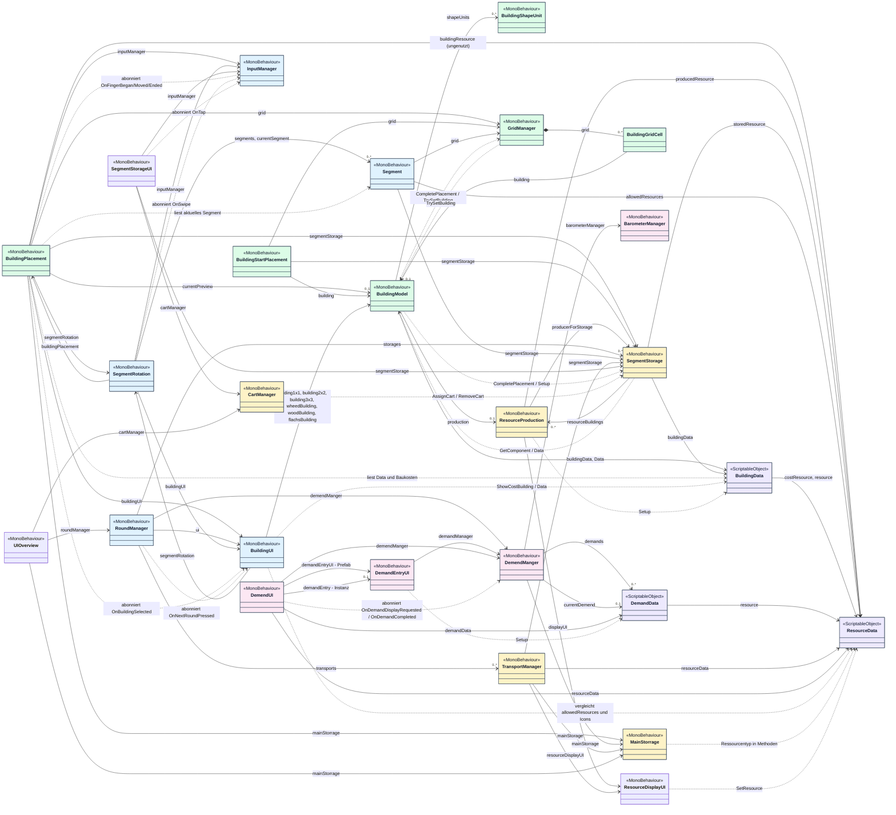

# UML-Klassendiagramme – SeriousGame AR

Stand: **16. November 2026**. Darstellung des gespeicherten Ist-Zustands, kein Refactoring-Vorschlag.

## Umfang

Untersucht wurden alle 27 C#-Dateien unter `Assets/_Project`: **26 Laufzeitklassen**, **zwei verschachtelte Enums**, **ein Editor-Werkzeug** und **eine Testklasse**. `BuildingGridCell` steht zusammen mit `GridManager` in derselben Datei. Paket-, Sample- und Drittanbieter-Implementierungen gehören nicht zu diesem Diagramm; benötigte Unity-Typen stehen als Feld-/Parametertypen darin. `SplineAnimate` ist zusätzlich als externe Klasse aufgeführt. Es gibt keine eigenen Interfaces.

Die Diagramme zeigen Klassen, nicht die Anzahl konkreter Szenenobjekte. Mehrere Segmentlager sind daher eine Klasse mit mehreren Instanzen. Es wurden keine Spielskripte, Prefabs, SOs oder Szenen verändert und keine Playmode-Tests durchgeführt.

## Diagramme öffnen

**[Offline-Ansicht im Browser öffnen](UML.html)** – acht Ansichten mit Zoom und SVG-Download. Alle Diagramme sind direkt eingebettet; kein Internet und kein Plugin erforderlich. Jede Ansicht liegt zusätzlich als skalierbare SVG-Datei und als Graphviz-DOT-Quelle vor. Die SVGs wurden mit Graphviz gerendert.

Die Markdown-Dateien enthalten Mermaid-Klassendiagramme und lassen sich in einer Markdown-Ansicht mit Mermaid-Unterstützung darstellen. Die gleichnamigen `.mmd`-Dateien enthalten jeweils nur die bearbeitbare Diagrammquelle. Die große Gesamtansicht ist zum Zoomen geeignet; für eine Präsentation sind die Teilansichten besser lesbar. Die Quelldateien benötigen keine Netzwerkverbindung; die Darstellung hängt von der Mermaid-Unterstützung des verwendeten Viewers ab.

- [Gesamtübersicht](00-Gesamtuebersicht.md) · [Mermaid-Quelle](00-Gesamtuebersicht.mmd)
- [Gebäudeplatzierung, Grid und Segmente](01-Platzierung-und-Segmente.md) · [Mermaid-Quelle](01-Platzierung-und-Segmente.mmd)
- [Runden, Ressourcen, Wagen und Lager-UI](02-Ressourcen-und-Transport.md) · [Mermaid-Quelle](02-Ressourcen-und-Transport.mmd)
- [Forderungen, UI und Barometer](03-Forderungen-und-Barometer.md) · [Mermaid-Quelle](03-Forderungen-und-Barometer.mmd)
- [ScriptableObjects und Enums](04-Daten.md) · [Mermaid-Quelle](04-Daten.mmd)
- [Vollständige Vererbung der Laufzeitklassen](05-Vererbung.md) · [Mermaid-Quelle](05-Vererbung.mmd)
- [Editor-Werkzeug und Testklasse](06-Editor-und-Tests.md) · [Mermaid-Quelle](06-Editor-und-Tests.mmd)
- [Vollständiges Klassendiagramm](07-Vollstaendiges-Klassendiagramm.md) · [Mermaid-Quelle](07-Vollstaendiges-Klassendiagramm.mmd)
- [Klassenkatalog mit Originalsignaturen und Quellverweisen](Klassenkatalog.md)

## Legende

| Darstellung | Bedeutung |
|---|---|
| `+ Feld / Methode` | public |
| `- Feld / Methode` | private; ohne C#-Sichtbarkeitsangabe ebenfalls private |
| `~` als Sichtbarkeit | internal |
| `<<MonoBehaviour>>` / `<<ScriptableObject>>` | tatsächliche Unity-Basisklasse; explizite Vererbung zusätzlich in Ansicht 05 und 07 |
| `A --> B` | A speichert eine Referenz auf B; Beschriftung nennt Feld/Property |
| `A ..> B` | A verwendet B vorübergehend oder abonniert dessen Event |
| `A *-- B` | A erzeugt und besitzt B: hier das Grid und seine gewöhnlichen C#-Zellobjekte |
| `Basis <\|-- Klasse` | Klasse erbt von Basis |
| `0..1` / `0..*` | optionale Referenz / mehrere Einträge; kein Nachweis korrekt gesetzter Inspector-Werte |

**Eventpfeile zeigen vom Abonnenten zum Herausgeber**, also die Code-Abhängigkeit. Die tatsächliche Nachricht läuft in die Gegenrichtung. Referenz- und Eventpfeil können zwischen denselben Klassen vorkommen. Nicht jede Unity-Eltern-Kind-Hierarchie ist UML-Komposition: Szeneobjekte werden deshalb überwiegend als normale Referenzen gezeigt.

Alle deklarierten eigenen Mitglieder stehen im vollständigen Diagramm und im Katalog, einschließlich Unity-Lebenszyklusmethoden und privater Helfer. Methoden mit Rückgabe `void` sind explizit so gekennzeichnet. Getter-Properties werden als Attribute dargestellt; ihre Setter-Sichtbarkeit steht im Katalog. `List~T~` ist die Mermaid-Schreibweise für `List<T>`. Mehrparametrige Generics des Editor-Werkzeugs sind in Mermaid auf den Containernamen verkürzt; SVG und Katalog zeigen die vollständigen Typen. Der Tupel-Rückgabewert von `WorldToGridPosition` ist im Diagramm als `ValueTuple` verkürzt; die Originalsignatur lautet `(int x, int z)`. Das zweiparametrige Event `OnDemandDisplayRequested` ist im Diagramm als `Action` verkürzt; der Katalog enthält `Action<DemandData, int>`.

## Gesamtübersicht

## Zentrale Zusammenhänge für die Übergabe

1. **Bauen:** `BuildingUI` meldet ein Prefab. `BuildingPlacement` liest das aktive `Segment`, erzeugt ein `BuildingModel` und verwendet es zuerst als Vorschau. Erst `CompletePlacement` registriert dessen Marker im Grid und initialisiert die optionale `ResourceProduction`. Die ursprünglichen Materialien und die Wrapper-Rotation bleiben am selben Modell erhalten. Kosten werden nach erfolgreicher Platzierung abgezogen.
2. **Startgebäude:** `BuildingStartPlacement` ruft denselben Abschlussweg auf, jedoch unabhängig von `BuildingPlacement`. Das Kontextmenü `SnapToGrid` existiert nur im Editor. Die Startplatzierung zieht keine Baukosten ab.
3. **Runden:** `BuildingUI.OnNextRoundPressed` erreicht `RoundManager`. Dieser startet alle eingetragenen Transporte, ruft danach `ProducePerRound` auf allen eingetragenen Lagern auf, erhöht die Rundenzahl und prüft Forderungen. Er wartet nicht auf die Transport-Coroutines.
4. **Ressourcen:** Ein Produzent liefert eine reine Menge an sein Lager. Das Lager speichert seinen Ressourcentyp aus den eigenen Gebäudedaten. Erst der Transport übergibt Menge plus Ressourcenart an `MainStorrage`. Gebäuderessource, Segmentfreigabe und Lagerressource müssen daher in der Konfiguration zusammenpassen.
5. **Wagen:** `CartManager` zählt global verfügbare Wagen. `SegmentStorage` zählt zugewiesene Wagen. `TransportManager` führt einen konkreten Segmenttransport aus; mehrere zugewiesene Wagen multiplizieren die Kapazität einer gemeinsamen Animation. Es gibt keine eigene Cart-Klasse oder Liste individueller Wagenobjekte.
6. **Forderungen:** `DemendManger` verwaltet eine aktive `DemandData`, prüft Abgaben und Fristablauf, verändert das Barometer und meldet Anzeige/Abschluss per Event. `DemendUI` erzeugt einen `DemandEntryUI`, dessen Buttons wiederum den Manager aufrufen. Aufschub verlängert nur die Frist und verändert das Barometer, ohne erneutes Popup.

## Tatsächlicher Stand und Grenzen

- Die bestehenden Namen einschließlich `MainStorrage`, `DemendManger`, `DemendUI`, `CanclePlacement` und `TranportLifeCycle` wurden bewusst unverändert übernommen.
- `Segment` hat keine TransportManager-Referenz. Die Transportliste liegt direkt im RoundManager; jeder Transport hat selbst seine Lagerreferenz.
- `BuildingGridCell` ist weder MonoBehaviour noch eigenes GameObject. Seine Lebensdauer hängt am erzeugten Grid-Array.
- Die Ressourcenfilterung der Bauauswahl liegt in `BuildingUI`, derzeit für den Ressourcen-Gebäudebutton. Im Platzierungsabschluss gibt es keine zusätzliche Prüfung des Ressourcentyps. `BuildingData.type` steuert den Produktionsstart nicht; entscheidend ist die vorhandene `ResourceProduction`-Komponente.
- `BuildingPlacement.buildingResource` und `BuildingModel.rotation` sind deklariert, werden im untersuchten Ablauf aber nicht genutzt. Der Wrapper wird direkt rotiert.
- Die beiden Transform-Parameter von `TranportLifeCycle` werden übergeben, aber im Methodenrumpf nicht verwendet. Die Bewegung folgt `SplineAnimate`.
- `BarometerManager.isGameOver` wird aktuell gesetzt, aber nicht als Sperre abgefragt. Es gibt weder ein Game-Over-Event noch eine globale Spielunterbrechung. `UpdateBarometer` startet für jeden Aufruf eine Coroutine, ohne eine laufende Bewegung zu stoppen. Das Diagramm behauptet deshalb keine bereits vorhandene Game-Over-Steuerung.
- `MainStorrage.gold` existiert als Bestand, während `ResourceType` nur None, WOOD, WHEED und FLACHS enthält. Die Ressourcenmethoden behandeln Gold aktuell nicht.
- Die Diagramme wurden gegen Klassen, Mitglieder und Referenzen des gespeicherten Codes abgeglichen. Sie sind keine Bestätigung aller Inspector-Zuweisungen oder ein Laufzeittest.

## Event-Verbindungen

| Herausgeber | Event | Empfänger / Handler |
|---|---|---|
| InputManager | OnFingerBegan | BuildingPlacement.OnTouchBegan |
| InputManager | OnFingerMoved | BuildingPlacement.OnTouchMoved |
| InputManager | OnFingerEnded | BuildingPlacement.OnTouchEnded |
| InputManager | OnSwipe | SegmentRotation.RotateOnSwipe |
| InputManager | OnTap | SegmentStorageUI.OpenUI |
| BuildingUI | OnBuildingSelected | BuildingPlacement.GetSelectedBuilding |
| BuildingUI | OnNextRoundPressed | RoundManager.StartNextRound |
| DemendManger | OnDemandDisplayRequested | DemendUI.DemandPopUP |
| DemendManger | OnDemandCompleted | DemendUI.RemoveDemandEntry |

## Prüfung der Dokumentation

Alle acht Graphviz-Diagramme wurden ohne Fehler oder Warnungen als SVG gerendert. Die Übersicht und die Forderungsansicht wurden zusätzlich rasterisiert und visuell kontrolliert. Klassenabdeckung, Quelldatei-Prüfsummen, HTML-JavaScript-Syntax, Ansichtswechsel und Zoom-Logik (mit DOM-Testdouble) sowie Download-Dateiverweise wurden geprüft. Ein vollständiger Browser-Test war nicht möglich, da der Headless-Browser in der Umgebung nicht startete. Details: [Prüfprotokoll](Pruefung.json).
